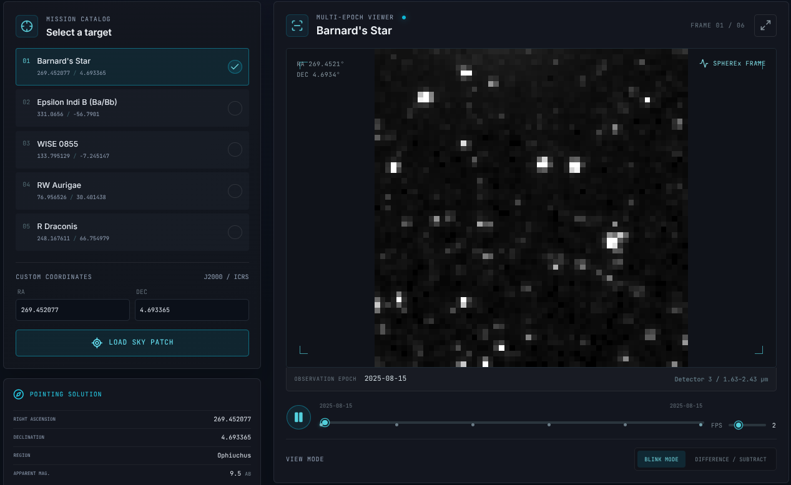
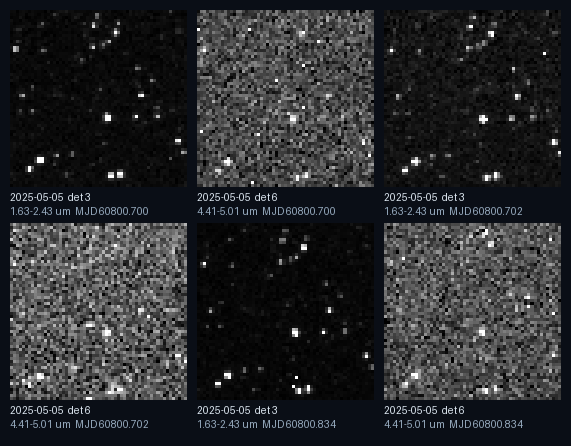

# Skytime

Explore real SPHEREx infrared image cutouts in a browser. Choose one of five preset targets or enter sky coordinates, then blink through returned frames, scrub the sequence, or compare a frame with the first frame from the same detector.

> Skytime is a working prototype for exploring survey data. It does not automatically detect moving objects or claim to find Planet X. Most checked preset results cover one observing day, and the difference view is a visual aid rather than calibrated photometry.
> 
> - Live app: <https://skytime-vercel-flat.vercel.app/>


## The app

The viewer displays a returned SPHEREx frame with its observation date, detector, and wavelength range. Controls let you move through the available frames and switch between blink and difference views.



The screenshot shows the app interface. Its instrument health and spectral panels are static placeholders, not real telemetry or measured spectra.

## Real image data

The image service searches SPHEREx Level-2 products through NASA/IPAC Infrared Science Archive (IRSA) SIA2 and requests cutouts around the selected sky position. Returned frames are oriented using FITS world-coordinate information and labelled with observation metadata.



These are real field cutouts near WISE 0855. Skytime does not claim to detect WISE 0855 in them. Different detectors cover different wavelength bands, and brightness differences between bands do not by themselves indicate change over time.

## Project components

- **Frontend:** React and Vite single-page app in [`nasa-front/`](nasa-front/).
- **Backend API:** ASP.NET Core on .NET 10 in this repository. It validates requests, caches results, and returns frame and target data.
- **Image service:** Python and FastAPI in [`image-service/`](image-service/). It searches IRSA, fetches FITS cutouts, and renders PNGs for the viewer.

## Run locally

### Requirements

- .NET 10 SDK
- Python 3 and the packages listed in [`image-service/requirements.txt`](image-service/requirements.txt)
- Node.js and npm for the frontend

Start the image service first when using real archive data. Follow its [setup instructions](image-service/README.md), then run the API from this repository:

```sh
dotnet run
```

The checked-in launch profile serves the API at `http://localhost:5012`.

Run the frontend in a second terminal:

```sh
cd nasa-front
npm install
npm run dev
```

For a demo without the image service, run the API in mock mode:

```sh
DataMode=mock dotnet run
```

Mock frames are generated demo content, not observed SPHEREx images. If the image backend is unreachable, the frontend may also show a local procedural preview; that preview is not real archive data.

## API routes

- `GET /api/frames?ra=...&dec=...&fov=...` — fetch frames for sky coordinates.
- `GET /api/frames/{id}/image` — return a frame image.
- `GET /api/targets` — list preset targets.
- `GET /api/catalog/targets` — list sample catalog targets.
- `GET /api/catalog/targets/{id}/observations` — list sample observations.
- `GET /images/{targetId}/{filename}` — serve catalog sample images.

See [`API_CONTRACT.md`](API_CONTRACT.md) for request and response details. Preset coordinates are in [`data/targets.json`](data/targets.json). Catalog records and files under `images/` are sample fixtures, not verified SPHEREx observations.

## Validation and checks

Validate the sample catalog with Python's standard library:

```sh
python tools/catalog/validate_catalog.py
```

The validator reports errors while the catalog contains placeholder values. To run the preset-target API checks, start the API in mock mode and run:

```sh
python3 tests/test_sample_targets.py
```

Set `SKYTIME_BASE_URL` to use a different API address. `tests/catalog-api.ps1` provides additional checks for catalog routes, CORS, and error responses.
